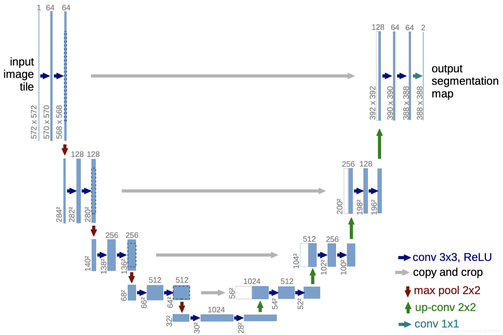
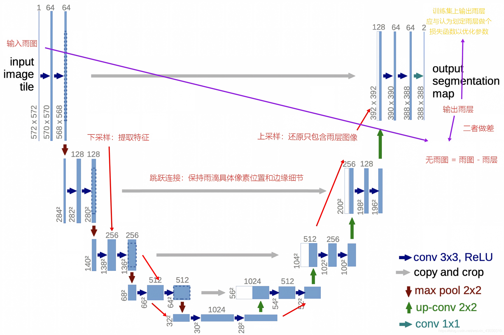

# 图像修复与对比学习（一）：从去雨任务开始

## Part1 基础

### 任务一：无雨 = 有雨 - 雨层 

#### 1. 基础问题：

- 我们应该让模型学习雨层，因为预期让模型直接学习有雨图到无语图的预测，更简单的方法是直接先让模型学习到哪些像素是雨，识别出雨层，我们只需要拿原图直接减去雨图就能得到无
雨图了。

- 借用了Unet的表示图

#### 2. 附加问题

1. 模型如何分辨谁是雨丝

- 雨丝相较于其他纹理特征有比较透明，分布广，颜色受雨滴所在背景影响的特征。模型可以通过提取这些特征区分雨滴于其他线性纹理

2. 模型还有可能复原出原来的物体吗?

- 比较困难，因为雨滴的覆盖导致了图像的缺失，但可以尝试先将雨层移除，使用图像修复技术根据其周围环境预测这里的像素值

