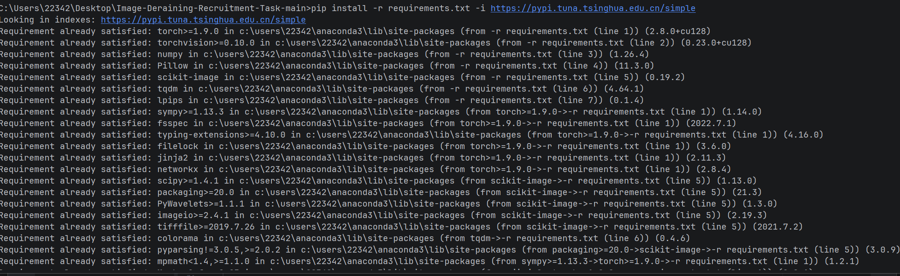
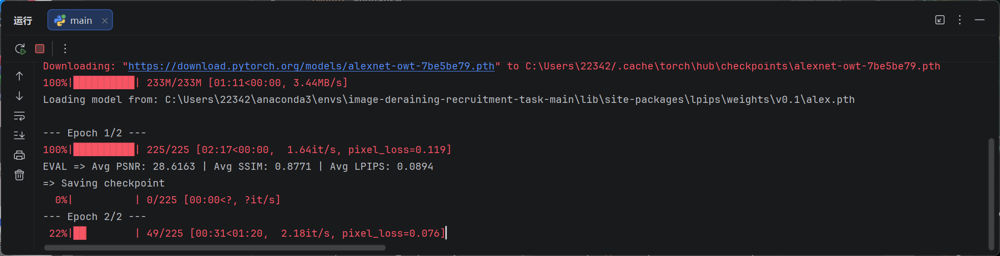
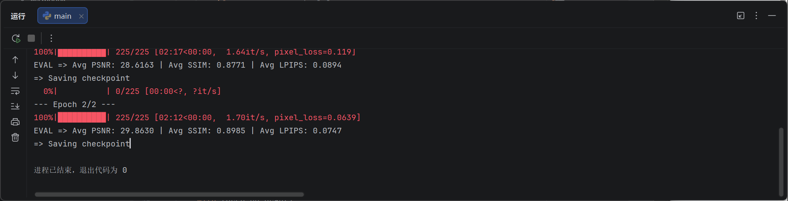

### 任务三：我有说明书，太好啦

#### 1. 环境搭建：小菜一碟



#### 2. 实现一个简单的模型


baseline_net的代码如下

        
```import torch.nn as nn


class ResidualBlock(nn.Module):
    def __init__(self, channels=64):
        super(ResidualBlock, self).__init__()
        # 两个 3x3 卷积层
        self.conv1 = nn.Conv2d(channels, channels, kernel_size=3, padding=1, bias=False)
        self.relu = nn.ReLU(inplace=True)
        self.conv2 = nn.Conv2d(channels, channels, kernel_size=3, padding=1, bias=False)

    def forward(self, x):
        return x + self.conv2(self.relu(self.conv1(x)))


class BaselineNet(nn.Module):
    def __init__(self):
        super(BaselineNet, self).__init__()
        # 1. 输入层
        self.input_conv = nn.Conv2d(in_channels=3, out_channels=64, kernel_size=3, padding=1)

        # 2. 中间层
        self.res_blocks = nn.Sequential(
            ResidualBlock(64),
            ResidualBlock(64),
            ResidualBlock(64)
        )

        # 3. 输出层 (1 个 3x3 卷积，输出预测的雨层)
        self.output_conv = nn.Conv2d(in_channels=64, out_channels=3, kernel_size=3, padding=1)

        #共8层

    def forward(self, x):
        feat = self.input_conv(x)
        feat = self.res_blocks(feat)

        # 得到网络预测的雨层
        rain_layer = self.output_conv(feat)

        # 原图 - 雨层 = 无雨图
        clean_image = x - rain_layer

        return clean_image


```

#### 2. 思考下面这个问题，并给出回答：

- 引入空洞卷积：在不增加参数和不损失分辨率的情况下，通过在卷积核中插入“空洞”，成倍扩大感受野。这样即使是很浅的网络也能捕捉到贯穿图像的长雨丝。

- 使用非对称卷积：将3x3卷积拆分为1x3（横向）和3x1（纵向），专门针对雨丝的线性特征进行特征提取，提高效率。

- 引入自注意力机制：不受限于局部卷积核，直接计算图像中任意两个像素点的相关性，获得全局视野，同时避免了深层网络带来的梯度消失问题。


#### 3. 这个代码是什么意思？

#### 1. 





#### 2. 将你学到的与代码相关的新东西写在这个小问中


- 命令行参数： 通过导入这个argparse 库，定义 get_args()，使用argparse.ArgumentParser()来方便地定义全局变量，这样就不用费力去改代码了。多方便啊。

- 5. 动态进度条与模型保存 (tqdm 与 checkpoint
进度条：使用了 tqdm(loader)，并利用 loop.set_postfix() 在进度条尾部实时显示当前的 Loss 值，方便我们直观监控模型是否在正常收敛。

- tqdm：刚开始运行时觉得这有点小帅，相比于我之前写的简陋而言而言。这种动态显示进度的库真的太方便了，直观，而且实现起来也不是很难。

- 从写程序的规范性角度来看，我自己写的代码太不规范了。看了看题目给的main的主干，越来越觉得规范的重要性，这种整齐的代码看起来舒服，要增删改查时也很方便，在py文件外，文件夹的分类也很重要，这至少比我分的好看多了

- 

